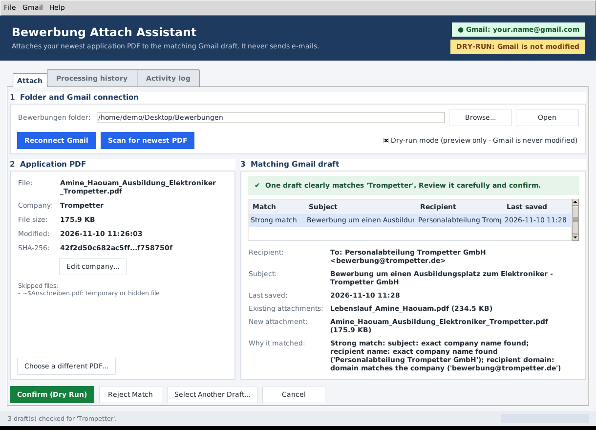
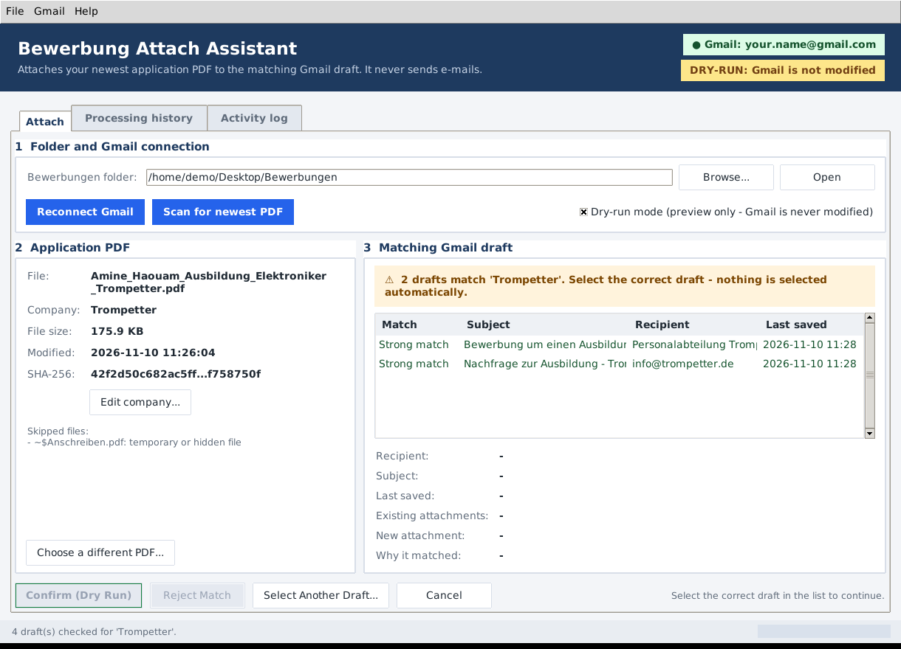
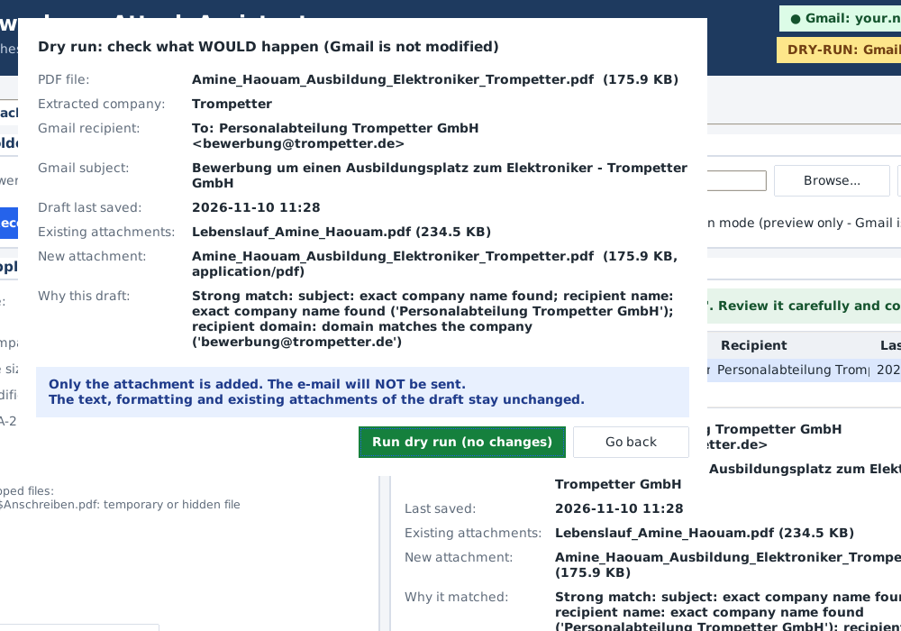
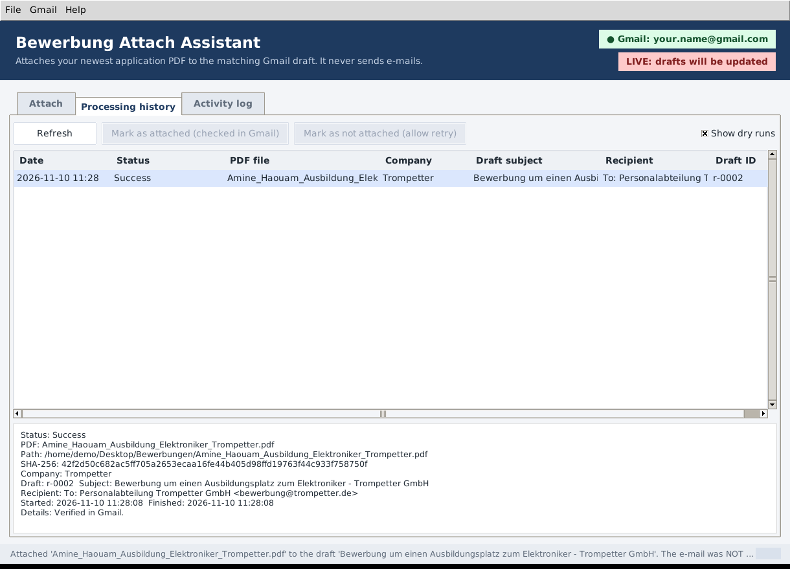

# Bewerbung Attach Assistant

A free, local Windows desktop application that takes the **newest unprocessed
application PDF** from your `Bewerbungen` folder, reads the **company name from
the file name**, finds the **matching existing Gmail draft**, and – after you
confirm – **attaches the PDF to that draft**.

It can **check automatically** for new PDFs (no need to click Scan) and,
if you switch it on, **send the e-mail automatically** – but only when exactly
one draft clearly matches. Everything unclear waits for you. With sending
switched off (the default), the only change it makes in Gmail is adding an
attachment to an existing draft after you confirm it.



---

## Contents

1. [Safety guarantees](#1-safety-guarantees)
2. [How it works](#2-how-it-works)
3. [Requirements](#3-requirements)
4. [Installation on Windows](#4-installation-on-windows)
5. [Creating Google OAuth credentials](#5-creating-google-oauth-credentials)
6. [Connecting Gmail](#6-connecting-gmail)
7. [Selecting the Bewerbungen folder](#7-selecting-the-bewerbungen-folder)
8. [File names and settings](#8-file-names-and-settings)
9. [Daily use](#9-daily-use)
10. [How drafts are matched](#10-how-drafts-are-matched)
11. [Testing the application safely](#11-testing-the-application-safely)
12. [Processing history and interrupted operations](#12-processing-history-and-interrupted-operations)
13. [Building a standalone .exe with PyInstaller](#13-building-a-standalone-exe-with-pyinstaller)
14. [Where your data is stored](#14-where-your-data-is-stored)
15. [Troubleshooting](#15-troubleshooting)
16. [Running the automated tests](#16-running-the-automated-tests)
17. [Project structure](#17-project-structure)
18. [Known limitations](#18-known-limitations)

---

## 1. Safety guarantees

| Guarantee | How it is enforced |
|---|---|
| Sends only when you enabled it | Sending is off by default. When enabled, a draft is sent only **after** the PDF was attached and verified in Gmail. Automatic sending (without a click) happens only when there is exactly one strong match, the company came from the file name and the draft has a recipient. A send is never retried (no double sending) and the same PDF is never sent twice. Sending exists in exactly one function; automated tests check this. |
| Never deletes drafts or creates new drafts | Every Gmail call goes through an allowlist (`SafeGmailService`) that only permits *read profile*, *list/read/update drafts* and *send an existing draft*; `create`, `delete` and the whole `messages` API are blocked before any request is made. |
| Never modifies a draft without approval | Manual attachments need a final confirmation dialog showing PDF, company, recipient, subject, date, existing and new attachments. The only exception is automatic sending, which you switch on yourself. |
| Never silently chooses between ambiguous drafts | If several drafts match, nothing is pre-selected; you must pick one. The newest draft is never preferred because it is the newest. |
| Weak / uncertain matches never lead to an attachment | Partial names or similar spellings are shown for reference only. To use such a draft you must select it manually and confirm an extra warning. |
| Keeps the draft's text, formatting and attachments | The complete original message is downloaded, one MIME part is added, and before uploading the new message is compared part-by-part with the original. Any difference aborts. After the upload the draft is read back and checked again. |
| Detects duplicates | Every processed PDF is stored with its SHA-256 hash – renamed or moved copies are recognised. Before attaching, the draft is checked for the same file (by content and by name). |
| Processes only one PDF per run | A scan selects exactly one PDF; there is no batch mode. |
| Never modifies your local PDFs | Files are only read (to hash and attach them). |
| Never asks for or stores your Gmail password | Sign-in uses Google's OAuth browser flow. The token is stored encrypted with Windows DPAPI. |
| Dry-run mode | Shows exactly what would happen (including the full safety check) without changing Gmail or sending anything. It is **on by default** on first start and overrides automatic sending. |

## 2. How it works

1. You write your cover letter as a **Gmail draft** (recipient, subject, text).
2. You save the application PDF in `Desktop\Bewerbungen`, named like
   `Amine_Haouam_Ausbildung_Elektroniker_Trompetter.pdf`.
3. You click **Scan for newest PDF**. The app selects the newest PDF that has
   not been processed yet and extracts the company (`Trompetter`).
4. It reads your Gmail drafts and searches for the company in the subject,
   the recipients (names and e-mail domains) and the text.
5. It shows the matching draft. You review it and click **Confirm and Attach**,
   then confirm once more in the summary dialog.
6. The PDF is added to the draft. The e-mail stays a draft – you send it
   yourself in Gmail whenever you are ready.

## 3. Requirements

* Windows 10 or 11
* Python **3.11 or newer** (from python.org; includes Tkinter) – not needed if
  you use a built `.exe`
* A Google account with Gmail
* A free Google Cloud project for the OAuth credentials (no billing account
  or credit card needed for the Gmail API)

All dependencies are free and open source: `google-api-python-client`,
`google-auth`, `google-auth-oauthlib`, `google-auth-httplib2` (Apache 2.0),
plus Tkinter, SQLite and the `email` package from the Python standard library.
PyInstaller (GPL with bootloader exception) is only needed to build an `.exe`.

## 4. Installation on Windows

### One-click installation (recommended)

Open a **Command Prompt** (`Win + R`, type `cmd`, Enter), paste this line and
press Enter:

```bat
powershell -NoProfile -ExecutionPolicy Bypass -Command "irm https://raw.githubusercontent.com/Aminehaouam/gmailpy/claude/great-brown-eyx5q1/install.ps1 | iex"
```

The installer does everything automatically:

1. installs Python 3.12 if no Python 3.11+ is present (no Git needed),
2. downloads the program to `C:\Users\<USERNAME>\BewerbungAttachAssistant`,
3. installs all libraries into a private environment,
4. runs the self-test,
5. creates a **"Bewerbung Attach Assistant"** icon on the Desktop and in the
   Start menu.

Alternatively download the ZIP (green **Code** button → *Download ZIP*, on the
branch shown in the URL above), extract it and double-click **`Install.bat`**.
Running the installer again later updates the program; your settings, Gmail
authorization and history are kept. Then continue with
[section 5](#5-creating-google-oauth-credentials).

The manual steps below are only needed if you prefer to install by hand.

### 4.1 Install Python

1. Download the current Python 3 installer from <https://www.python.org/downloads/windows/>.
2. Run it and tick **"Add python.exe to PATH"**. Keep the default optional
   features – **"tcl/tk and IDLE"** must stay selected (this is Tkinter).
3. Open a new *Command Prompt* (`Win + R`, `cmd`, Enter) and check:

   ```bat
   py --version
   ```

### 4.2 Get the application

Either download the repository as ZIP (green **Code** button → *Download ZIP*)
and extract it, for example to `C:\Users\<USERNAME>\BewerbungAttachAssistant`,
or clone it with Git:

```bat
git clone https://github.com/aminehaouam/gmailpy.git C:\Users\%USERNAME%\BewerbungAttachAssistant
```

### 4.3 Create a virtual environment and install the dependencies

In the Command Prompt:

```bat
cd C:\Users\%USERNAME%\BewerbungAttachAssistant
py -3 -m venv .venv
.venv\Scripts\python.exe -m pip install --upgrade pip
.venv\Scripts\python.exe -m pip install -r requirements.txt
```

### 4.4 Check the installation

```bat
.venv\Scripts\python.exe main.py --self-test
```

All lines should say `[OK]` (including `Token storage: DPAPI encryption OK`).

### 4.5 Start the application

```bat
.venv\Scripts\python.exe main.py
```

or double-click **`start.bat`** (starts without a console window). To create
a desktop shortcut, right-click `start.bat` → *Send to* → *Desktop (create shortcut)*.

Command-line options:

| Option | Effect |
|---|---|
| `--dry-run` | Locks dry-run mode on for this session (preview only, Gmail is never modified) |
| `--self-test` | Checks all components and exits |
| `--version` | Prints the version |
| `--data-dir <folder>` | Uses another folder for settings, token, history and logs |

## 5. Creating Google OAuth credentials

You create your own OAuth client once. It stays in your Google account; no
one else can use it.

> The Google Cloud Console is redesigned from time to time. The menu names
> below are current at the time of writing; if something looks different,
> search the console for the item in **bold**.

1. **Create a project.** Open <https://console.cloud.google.com/>, click the
   project selector at the top → **New project** → name it e.g.
   `Bewerbung Attach Assistant` → **Create**, and make sure it is selected.
2. **Enable the Gmail API.** Menu → *APIs & Services* → **Library** → search
   **Gmail API** → open it → **Enable**.
3. **Configure the consent screen.** Menu → *APIs & Services* → **OAuth consent
   screen** (opens *Google Auth Platform*) → **Get started**:
   * App name: `Bewerbung Attach Assistant`; User support email: your address
   * Audience: **External**
   * Contact information: your address → agree to the policy → **Create**
4. **Add yourself as a test user.** *Google Auth Platform* → **Audience** →
   *Test users* → **Add users** → enter your Gmail address → **Save**.
5. **(Recommended) Declare the scope.** *Google Auth Platform* → **Data Access**
   → **Add or remove scopes** → filter for `gmail.compose`, tick
   `https://www.googleapis.com/auth/gmail.compose` → **Update** → **Save**.
6. **Create the OAuth client.** *Google Auth Platform* → **Clients** →
   **Create client** → Application type: **Desktop app** → name it → **Create**.
7. **Download the JSON file** in the dialog that appears (**Download JSON**).
   Do this immediately – Google may not show the client secret again later.
   Keep the file private (do not e-mail it or put it in a public repository).

**About "Testing" mode:** while the app's publishing status is *Testing*,
Google expires the sign-in after **7 days**. The application detects this and
simply asks you to click **Connect Gmail** again. If you prefer not to sign in
weekly, you can set the publishing status to *In production* (*Audience* →
*Publish app*); because the app is not verified by Google, the sign-in page
then shows a warning that you can accept for your own app.

**About the permission:** the app requests only
`https://www.googleapis.com/auth/gmail.compose`, which Google describes as
"Manage drafts and send emails". It is the narrowest Google permission that
allows reading **and** updating drafts – Google offers no "drafts only"
permission. According to Google's API description it allows exactly: reading
the account address, listing/reading/creating/updating/deleting/sending
drafts, and sending messages. It does **not** allow reading your inbox or
any other e-mail. Of these operations the application uses *read address*,
*list drafts*, *read draft*, *update draft* and – only if you enable sending –
*send draft*; creating and deleting drafts and sending other messages are
blocked by its built-in allowlist (see
[Safety guarantees](#1-safety-guarantees)).

## 6. Connecting Gmail

1. Start the application and click **Connect Gmail**.
2. The first time, select the JSON file from step 5.7. It is validated and
   copied into the app's data folder, so you can delete the download afterwards.
3. Your browser opens the Google sign-in. Choose your Gmail account.
4. Google shows *"Google hasn't verified this app"* – this is expected for
   your own OAuth client. Click **Continue**.
5. Allow the requested access. The browser then says the app is connected;
   close the tab.
6. The window header now shows **Gmail: your.address@gmail.com**.

The authorization token is stored **encrypted with Windows DPAPI** (only your
Windows user account on this PC can decrypt it). The next start connects
automatically. **Gmail → Disconnect and remove token** revokes the token at
Google and deletes it locally. You can also revoke access at any time at
<https://myaccount.google.com/permissions>.

If the browser does not open automatically, the sign-in link is written to
the **Activity log** tab; copy it into your browser. The sign-in must be
completed within 5 minutes.

## 7. Selecting the Bewerbungen folder

* Default: `C:\Users\<USERNAME>\Desktop\Bewerbungen` (if your Desktop is
  synchronised with OneDrive, the OneDrive Desktop is used automatically).
* Click **Browse...** to choose another folder. The choice is saved.
* If the folder does not exist yet, the app offers to create it.
* Only the folder itself is scanned, not its sub-folders – so you can keep an
  `Archiv` sub-folder for old documents.

## 8. File names and settings

Expected structure:

```
<Applicant name>_<Application type>_<Job title>_<Company>.pdf

Amine_Haouam_Ausbildung_Elektroniker_Trompetter.pdf
    -> company "Trompetter"
Amine_Haouam_Ausbildung_Elektroniker_Barth_und_Kerner_GmbH.pdf
    -> company "Barth und Kerner GmbH"
```

Rules (defaults, changeable under **File → Settings...**):

* The first components must be the applicant name **Amine Haouam**
  (leave the field empty to accept any name; then *Name parts* = 2 is used).
* Then the application type **Ausbildung**, then the job title
  **Elektroniker**. Several types/titles can be entered, comma-separated;
  multi-word titles work (`Elektroniker für Betriebstechnik`), the longest
  matching title wins.
* Everything after the job title is the company name; underscores become
  spaces. Company names can have any number of words.
* Copy markers (`... (1).pdf`, `... - Kopie.pdf`) and version markers at the
  end (`_v2`, `_final`) are ignored.
* The original file name is never changed.

If a file name does **not** follow this structure (e.g. a different job
title, or no company), the app does **not guess**: it asks you to type the
company name. You can also correct an extracted name at any time with
**Edit company...**.

Advanced settings (e.g. ignored e-mail provider domains, maximum number of
drafts, file-age threshold) are in `config.json` in the data folder
(see [section 14](#14-where-your-data-is-stored)).

## 9. Daily use

1. Create the Gmail draft for the application (recipient + subject + text).
2. Save the application PDF into the Bewerbungen folder with the naming
   scheme above.
3. Click **Scan for newest PDF**. The PDF card shows the file, extracted
   company, size and hash. Files that were skipped (still being written,
   temporary, incomplete, already processed) are listed with the reason.
4. The draft card shows the result of the search:
   * **Confirm and Attach** – opens the final summary; confirm it to attach.
   * **Reject Match** – the proposed draft is wrong; it is excluded and the
     remaining candidates (if any) are shown.
   * **Select Another Draft...** – choose any draft manually (drafts without a
     strong match need an extra confirmation).
   * **Cancel** – stop; nothing is attached.
5. After a successful attachment, scan again for the next PDF. Each scan
   handles exactly one PDF.

**Choose a different PDF...** lets you process an older unprocessed PDF
first (for example if the draft for the newest PDF does not exist yet).

> Tip: close the draft in Gmail (browser or phone) before attaching.
> Otherwise Gmail's autosave of the open draft could overwrite the change.

### Fully automatic mode (no clicks)

Set this once in the main window (the settings are saved):

* tick **Check automatically for new PDFs**,
* tick **Send e-mail automatically after attaching**,
* untick **Dry-run mode**.

From then on the app works on its own, every **2 seconds**:

1. It looks at the **latest PDF** in the Bewerbungen folder (newest saved,
   created or copied file – only that one).
2. If it was not sent yet, it reads the company from the file name.
3. It looks at your **most recent drafts** (fast – not the whole mailbox) and
   picks the draft for that company: the one draft whose subject or
   recipient clearly contains the company, otherwise **your latest draft**
   if it mentions the company anywhere (subject, recipient or text).
4. It attaches the PDF and **sends the e-mail**, and plays a short
   **success chime**. The banner shows "Last sent: ...".

It never opens a dialog in this mode. If something does not fit yet, the
banner says why and the app simply looks again (every 3 seconds), for
example:

* "no recent draft mentions 'Trompetter' yet" – write the draft; it is sent
  as soon as it exists,
* "the draft has no recipient yet" – a draft is only sent when it has a
  recipient, a subject and some text. As soon as a fitting draft exists it is
  sent **immediately** (no waiting time). Careful: Gmail saves drafts while
  you type, so a draft you are still typing could be sent as soon as it has
  recipient, subject and text – write the draft first, then save the PDF, or
  set `draft_settle_seconds` (e.g. 60) in `config.json` to require a pause,
* "company not readable from the file name" – rename the file.

A PDF that was sent is never sent again (also not after renaming). If
sending fails, the PDF stays attached to the draft and the banner says
"Needs your attention". The timings can be changed in `config.json`
(`watch_interval_seconds`, `draft_settle_seconds`, `auto_retry_seconds`,
`play_sound`).

With only *Check automatically* ticked (sending off), a new latest PDF is
shown for you to confirm instead.

**Keep it running:** the app only watches while it is open. To start it
automatically (minimized) whenever you log in to Windows:

1. Press `Win + R`, type `shell:startup`, press Enter – a folder opens.
2. Right-click the **Bewerbung Attach Assistant** icon on your Desktop →
   *Copy*, then right-click in the opened folder → *Paste shortcut*.
3. Optional: right-click the new shortcut → *Properties* → *Run:*
   **Minimized**, and add ` --minimized` at the end of *Target*.

To stop auto-start, delete the shortcut from that folder again.

Recommended first use: enable both checkboxes **with dry-run on**, save a
test PDF and check in the history that it says the PDF *would be attached
and sent* to the right draft. Then switch dry-run off.

## 10. How drafts are matched

The company name is compared with each draft after normalisation: case,
punctuation and extra spaces are ignored; umlauts match their spellings
(`Müller` = `Mueller`); legal forms are optional (`Trompetter` matches
`Trompetter GmbH`); `und`, `&` and `and` are equivalent.

| Where the full company name is found | Strength |
|---|---|
| Subject, recipient name, or recipient e-mail domain (`bewerbung@trompetter.de`) | **Strong** |
| Only the e-mail text (or only the part before `@`) | **Possible** |
| Only part of the name, a similar spelling, or the name inside a longer word | **Weak** (never sufficient) |

E-mail domains of general providers (gmail.com, gmx.de, web.de, ...) are
never used as evidence.

| Situation | What the app does |
|---|---|
| Exactly one strong match | Shows it pre-selected; you review and confirm. |
| No strong but exactly one possible match | Shows it with a warning to check recipient and subject carefully; you confirm. |
| Several plausible drafts | Lists them all with recipient, subject and date. **Nothing is selected**; you must choose. |
| Only weak matches | **Stops.** Nothing is attached. Candidates are listed for reference; edit the company name or select a draft manually. |
| No match | **Stops.** Nothing is attached. |



Before attaching, the app downloads the current version of the draft and
checks that it has not changed since the preview, that the PDF (same content
or same file name) is not attached already, and that Gmail's 25 MB attachment
limit is respected. The final summary looks like this:



## 11. Testing the application safely

Do this once before using the app for real applications.

1. **Start in locked dry-run mode:**
   ```bat
   .venv\Scripts\python.exe main.py --dry-run
   ```
   (or `start.bat --dry-run`). The header shows *DRY-RUN: Gmail is not modified*.
2. **Create a test draft** in Gmail: recipient = **your own address**,
   subject = `Test Bewerbung Testfirma`, some text with formatting (bold,
   a list) and, optionally, an attachment such as a small image.
3. **Create a test PDF**: copy any PDF into the Bewerbungen folder and rename
   it to `Amine_Haouam_Ausbildung_Elektroniker_Testfirma.pdf`.
4. Click **Connect Gmail** (first time: see section 6), then **Scan for newest PDF**.
5. Check: the PDF card shows company **Testfirma**; the draft card shows your
   test draft as a **strong match** with the correct recipient and subject.
6. Click **Confirm (Dry Run)** and then **Run dry run (no changes)** in the
   summary. The result says the PDF *would* be attached and that all safety
   checks passed. Open the draft in Gmail – it is unchanged.
7. **Real test:** close the app, start it normally (without `--dry-run`),
   untick **Dry-run mode**, scan again and confirm. Then open the test draft
   in Gmail and check that the PDF is attached and that text, formatting and
   any previous attachment are unchanged. The draft has **not** been sent.
8. Scan again: the test PDF is now reported as *already processed*. Rename
   the PDF and scan again – it is still recognised (SHA-256 hash).
9. Delete the test draft in Gmail yourself and optionally remove the test
   PDF. The test entry remains in the history (harmless).

Optional negative tests: rename the PDF to a company without a draft
(→ "No draft mentions ..."), or create two drafts mentioning `Testfirma`
(→ you must choose one).

## 12. Processing history and interrupted operations

The **Processing history** tab lists every attempt with date, status, PDF,
company, draft subject, recipient and draft id; select an entry to see its
details (path, SHA-256 hash, messages).



| Status | Meaning | PDF picked again automatically? |
|---|---|---|
| Success | Gmail confirmed the update and the draft was verified | No |
| Attached and SENT | Attached, verified and sent | No |
| Attached, NOT sent / send unclear | Attached, but sending failed or the result is unclear – check Gmail | No |
| Already attached (no change) | The PDF was found in the draft already | No |
| Dry run (no change) | Preview only | Yes |
| Failed | Gmail was not changed (error shown in details) | Yes |
| Unverified - check draft | The outcome is unclear (e.g. connection lost during the upload) | No – check the draft in Gmail, then use **Mark as attached** or **Mark as not attached** |
| Interrupted / in progress | The app was closed or crashed during an upload | No – checked automatically at the next Gmail connection |

Every real attachment is written to the history as *in progress* **before**
Gmail is contacted. If the app is interrupted, the next connection reads the
draft and resolves the entry automatically (PDF present → success; absent →
failed, so it can be retried). An entry is only marked *Success* after Gmail
confirmed the update.

## 13. Building a standalone .exe with PyInstaller

The `.exe` runs on Windows PCs without a Python installation.

**Easiest:** double-click **`build_exe.bat`**. It creates the virtual
environment if needed, installs the dependencies and PyInstaller, runs the
tests, builds the executable and runs its self-test.

**Manually** (Command Prompt in the project folder):

```bat
.venv\Scripts\python.exe -m pip install -r requirements-dev.txt
.venv\Scripts\pyinstaller.exe --noconfirm --clean BewerbungAttachAssistant.spec
```

Result: **`dist\BewerbungAttachAssistant.exe`** (about 25 MB, one file, no
console window). Copy it anywhere, e.g. to the Desktop. Check it with:

```bat
dist\BewerbungAttachAssistant.exe --self-test
```

(a window with the results opens). The spec file bundles only Gmail's API
description; the equivalent one-line command also works but produces a larger,
slower-starting file because it bundles ~600 unused API descriptions:

```bat
.venv\Scripts\pyinstaller.exe --noconfirm --clean --onefile --windowed --name BewerbungAttachAssistant main.py
```

Notes: Windows SmartScreen or antivirus software may warn about unsigned,
self-built executables (*More info → Run anyway*). Settings, token and history
are not inside the `.exe`; they stay in the data folder, so a new build
continues where the old one stopped.

## 14. Where your data is stored

Folder: `%LOCALAPPDATA%\BewerbungAttachAssistant` (open it via
**File → Open data folder**).

| File | Content |
|---|---|
| `config.json` | Settings (folder, dry-run, file name rules, ...) |
| `client_secret.json` | Copy of your OAuth client file |
| `token.bin` | Gmail authorization token, DPAPI-encrypted |
| `history.sqlite3` | Processing history (file name, path, SHA-256, company, draft id, subject, recipients, time, status, error) |
| `logs\bewerbung_attach_assistant.log` | Operation log (rotated, max. 6 × 2 MB). Access tokens, refresh tokens, client secrets and authorization codes are automatically removed from every log line. |

To reset the app completely, close it and delete this folder.

## 15. Troubleshooting

| Problem | Solution |
|---|---|
| `Error 403: access_denied` during sign-in | Add your Gmail address as a **test user** (section 5, step 4). |
| `Error 400: redirect_uri_mismatch` or "This is a Web application client" | The OAuth client must be of type **Desktop app** (section 5, step 6). |
| "Gmail: sign-in expired" | Normal in Testing mode after 7 days, or after revoking access. Click **Connect Gmail**. |
| "The Gmail permission is missing" | Disconnect (Gmail menu), connect again and allow the requested access. |
| Newest PDF is not chosen | See *Skipped files* in the PDF card: still being written (wait a few seconds), already processed, temporary/hidden, or incomplete PDF. |
| "Expected a known job title ..." | Add the job title under **File → Settings...**, or type the company name when asked. |
| "No draft mentions ..." | Check the spelling in the file name vs. the draft; use **Edit company...**; or select the draft manually. |
| "The draft was changed in Gmail after it was shown here" | The draft was edited meanwhile; the app reads the drafts again – review and confirm again. |
| "A different attachment named ... is already attached" | Remove the old version in Gmail first (the app never removes attachments). |
| "The draft's internal structure is damaged or unusual" | The draft cannot be modified safely – attach the PDF manually in Gmail. |
| Attachment disappeared later | The draft was open in Gmail and its autosave overwrote the change – close drafts before attaching. |
| "Bewerbung Attach Assistant is already running" | Only one instance may run at a time; use the open window. |
| Anything else | Check the **Activity log** tab or the log file (File → Open log folder). |

## 16. Running the automated tests

```bat
.venv\Scripts\python.exe -m pip install -r requirements-dev.txt
.venv\Scripts\python.exe -m pytest
```

The tests use the real `google-api-python-client` (built from its bundled
Gmail API description) with a mocked HTTP layer, plus an in-memory Gmail
simulation – they never contact Google. They cover company extraction
(including multi-word names and malformed file names), folder scanning
(temporary, incomplete and still-written files; renamed duplicates),
matching (strong/possible/weak/none, multiple candidates, newest draft never
preferred), byte-level preservation of draft bodies, HTML, inline images and
existing attachments, duplicate attachment detection, the attach flow with
Gmail errors, timeouts, interruptions and recovery, the exact HTTP requests
sent to Gmail, the database, log redaction, the GUI workflow, and static and
runtime checks that no send/create/delete call exists.

## 17. Project structure

| File | Purpose |
|---|---|
| `main.py` | Entry point: command-line options, logging, single-instance lock, self-test |
| `gui.py` | Tkinter/ttk interface (main window, dialogs, history, activity log) |
| `gmail_client.py` | OAuth sign-in, allowlisted Gmail API access, draft parsing, error handling |
| `file_scanner.py` | Selects the newest unprocessed, complete PDF |
| `filename_parser.py` | Configurable company-name extraction |
| `matching_engine.py` | Normalised matching and safety rules |
| `attachment_manager.py` | Safe draft modification, preservation checks, verification, recovery |
| `database.py` | SQLite processing history |
| `config.py` | Settings, defaults and file locations |
| `secure_storage.py` | DPAPI-encrypted token storage |
| `logging_setup.py` | Log file with secret redaction |
| `BewerbungAttachAssistant.spec`, `build_exe.bat` | PyInstaller build |
| `Install.bat`, `install.ps1` | One-click installer (Python, libraries, shortcuts) |
| `start.bat` | Starts the app from the virtual environment |
| `tests/` | Automated tests |

## 18. Known limitations

* Gmail's web/mobile editor can overwrite the draft if it is open while the
  PDF is attached (autosave). Close the draft first.
* Drafts with a damaged or very unusual MIME structure are refused for
  safety; attach the PDF manually in that case.
* By default up to 500 drafts are read per scan (`matching.max_drafts` in
  `config.json`). The first scan reads every draft; later scans in the same
  session only read drafts that changed.
* Automatic sending trusts a strong match. If two different applications go
  to the same company, make sure only one draft exists at a time, or leave
  automatic sending off.
* Self-built `.exe` files are unsigned and may trigger SmartScreen warnings.

The screenshots in this document were rendered with sample data; fonts look
slightly different on Windows.
